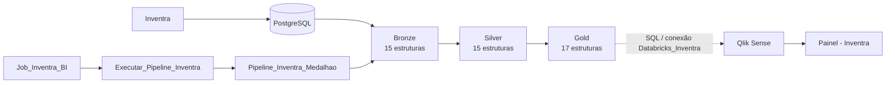

# Inventra Business Intelligence

Pipeline de Engenharia de Dados e Business Intelligence para apoiar a análise de estoque, validade, abastecimento e inventários do **Inventra**, uma solução de gestão de estoque para cozinhas industriais.

O projeto conecta dados operacionais em PostgreSQL a uma arquitetura Medalhão no Databricks e disponibiliza a camada analítica no Qlik Sense.

## Visão geral

O projeto foi desenvolvido para transformar registros operacionais do Inventra em informações gerenciais que permitam investigar questões como:

- quais lotes possuem saldo disponível;
- quais lotes estão vencidos ou próximos do vencimento;
- quais combinações produto/cozinha estão abaixo ou acima dos parâmetros de estoque;
- onde está concentrado o valor financeiro do estoque;
- quais requisições precisam ser analisadas;
- quais fornecedores podem ser comparados;
- onde existem divergências entre estoque registrado e contagem física.

> **Contexto dos dados:** ambiente acadêmico e demonstrativo. As evidências analisadas utilizam dados fictícios e não representam uma operação empresarial real.

---

## Arquitetura



O Databricks organiza os dados em três camadas:

| Camada | Objetivo |
|---|---|
| Bronze | Receber dados próximos da origem PostgreSQL |
| Silver | Aplicar tratamentos, padronizações e regras de qualidade |
| Gold | Disponibilizar estruturas orientadas à análise e aos indicadores do BI |

O pipeline demonstrado contém **47 estruturas**, distribuídas em:

- 15 Bronze;
- 15 Silver;
- 17 Gold.

---

## Pipeline de dados

O processamento é realizado pelo:

`Pipeline_Inventra_Medalhao`

<p align="center">
  
</p>

Entre os tratamentos documentados estão:

- deduplicação por identificadores;
- limpeza e padronização de textos;
- conversão de tipos de datas e quantidades;
- relacionamentos utilizando chave produto/cozinha;
- regras de qualidade monitoradas;
- cálculo de indicadores de estoque abaixo do mínimo e acima do máximo;
- preparação das estruturas analíticas utilizadas no Qlik Sense.

---

## Orquestração

A execução do pipeline é orquestrada pelo Job:

`Job_Inventra_BI`

com a task:

`Executar_Pipeline_Inventra`

A task executa o `Pipeline_Inventra_Medalhao` utilizando atualização completa.

<p align="center">
  
</p>

As evidências do projeto mostram execuções manuais e programadas concluídas com sucesso.

O agendamento demonstrado no Databricks é diário às **07:50**. O fuso horário dessa configuração não foi confirmado nas evidências analisadas.

---

## Integração Databricks → Qlik Sense

O aplicativo Qlik utiliza uma conexão denominada:

`Databricks_Inventra`

O script de carga consulta estruturas da camada Gold, por exemplo:

```sql
SQL SELECT *
FROM inventra.inventra_gold.gld_perfis;
```

<p align="center">
  
</p>

Detalhes sensíveis da conexão, como credenciais e endpoint, não são armazenados neste repositório.

---

# Dashboard Qlik Sense

Aplicativo:

`Painel - Inventra`

O dashboard foi dividido em quatro frentes analíticas.

## 1. Visão geral

Apresenta o panorama do estoque e os principais sinais de atenção.

Principais análises:

- valor atual do estoque;
- lotes com saldo;
- estoque abaixo do mínimo;
- lotes vencidos com saldo;
- valor por cozinha;
- composição financeira por categoria;
- entradas registradas por período.

<p align="center">
  
</p>

---

## 2. Estoque e validade

Concentra a investigação de disponibilidade, validade e excesso.

Entre os objetos apresentados estão:

- lotes a vencer;
- valor associado aos lotes a vencer;
- combinações acima do estoque máximo;
- concentração financeira por produto;
- distribuição do valor dos lotes entre cozinhas;
- detalhamento dos lotes e quantidades.

<p align="center">
  
</p>

---

## 3. Compras e fornecedores

Relaciona a demanda registrada às alternativas de abastecimento.

Principais análises:

- requisições registradas;
- requisições sem aprovação datada;
- itens das requisições;
- requisições por cozinha;
- produtos mais requisitados;
- comparação de fornecedores;
- distribuição dos prazos;
- relação entre preço de referência e prazo de entrega.

<p align="center">
  
</p>

---

## 4. Inventário, alertas e controle

Apoia a conferência entre registros do sistema e contagens físicas.

Principais análises:

- inventários;
- contagens divergentes;
- alertas;
- divergências por cozinha;
- divergências por semana;
- inventários e responsáveis;
- detalhamento das contagens.

<p align="center">
  
</p>

---

# Indicadores e evidências

Uma consulta da camada Gold registrada em 25/10/2026 apresentou:

| Indicador | Resultado observado |
|---|---:|
| Valor registrado em estoque | R$ 1.326.982,08 |
| Lotes com saldo | 474 |
| Produtos com saldo | 254 |
| Lotes vencidos com saldo | 19 |
| Proporção aproximada de lotes vencidos entre lotes com saldo | 4,0% |

Esses números pertencem à consulta Gold registrada naquela evidência.

Capturas do Qlik realizadas em outros momentos apresentam valores diferentes. Por esse motivo, resultados das diferentes fontes não são tratados como uma única posição operacional homologada.

---

# Principal aprendizado gerencial

O valor total registrado em estoque não deve ser interpretado isoladamente como disponibilidade efetiva.

A análise precisa considerar simultaneamente:

1. saldo;
2. validade;
3. parâmetros mínimos e máximos;
4. requisições em andamento;
5. fornecedores;
6. divergências entre registro e contagem física.

No recorte analisado, a principal prioridade identificada foi a conferência dos lotes vencidos que ainda apresentavam saldo registrado.

---

# Tecnologias

- PostgreSQL
- Databricks
- Databricks ETL Pipelines
- SQL
- Qlik Sense
- Git
- GitHub

---

# Estrutura do repositório

```text
inventra-business-intelligence/
│
├── README.md
├── .gitignore
│
├── databricks/
│   ├── README.md
│   └── pipeline-source/
│
├── qlik/
│   ├── README.md
│   ├── load-script/
│   └── app/
│
├── docs/
│   └── report/
│
└── assets/
    └── images/
        ├── databricks/
        ├── qlik/
        └── report/
```

---

# Atualização dos dados

O projeto demonstra uma arquitetura de atualização composta por:

```text
PostgreSQL
      ↓
Databricks
      ↓
Bronze
      ↓
Silver
      ↓
Gold
      ↓
Qlik Sense
```

O Job do Databricks possui agendamento diário demonstrado às 07:50.

O material também apresenta uma configuração de atualização do Qlik às 08:10 em `America/Sao_Paulo`.

As evidências disponíveis não são suficientes para afirmar que toda a cadeia Databricks → Qlik já está homologada como processo de produção totalmente automatizado.

---

# Relatório gerencial

A análise completa, incluindo metodologia, indicadores, limitações, evidências e recomendações, está disponível no relatório:

[📄 Abrir relatório gerencial](docs/report/inventra-business-intelligence-relatorio-gerencial.pdf)

---

# Limitações

Este projeto utiliza um ambiente acadêmico/demonstrativo.

Os números exibidos:

- não comprovam dados de produção;
- não representam resultados financeiros reais;
- não comprovam redução de desperdício;
- não comprovam economia obtida;
- não devem ser interpretados como indicadores oficiais de uma empresa real.

O projeto demonstra principalmente a construção da arquitetura de dados, do pipeline analítico e da experiência de Business Intelligence.

---

# Contexto

Projeto desenvolvido como parte do **Inventra**, solução de gestão de estoque voltada a cozinhas industriais, com foco em rastreabilidade, análise de validade, abastecimento e controle de inventário.
